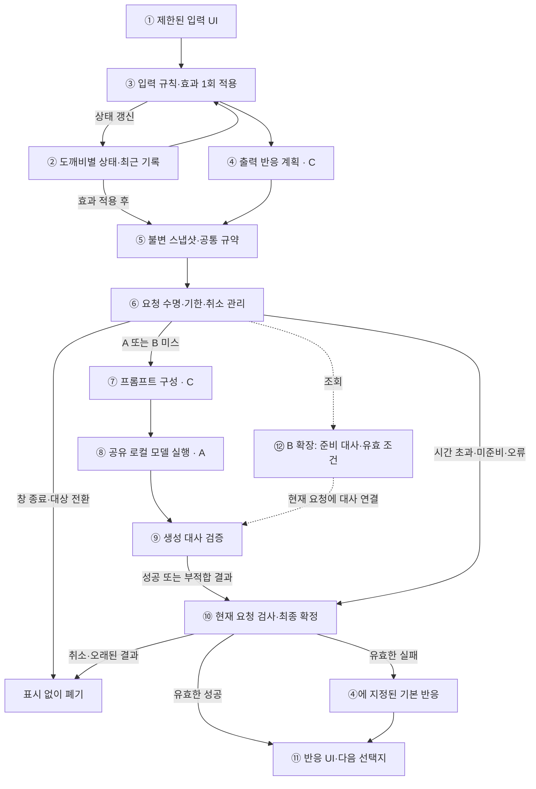
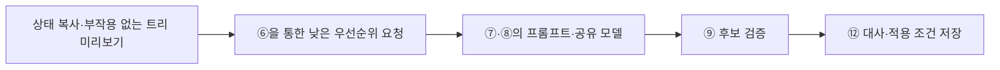

# 도깨비 AI 시스템 얼개와 구성 요소 주석

기준일: 2026-10-12. **A+C를 먼저 구현하고 B로 확장**하는 도깨비 상호작용 시스템의 계획 구조다. 모델·추론 엔진이 미선정이므로 특정 신경망의 레이어 수/구조를 확정하지 않는다. 여기서는 모델을 게임에 연결하는 구성과 데이터·제어 흐름을 설명한다.

현재 구현된 것은 **⑤의 공통 데이터 규약과 선택/결과 식별 검사 함수**다. 그림의 상태 관리·트리·서비스·프롬프트·실제 추론·UI·캐시는 후속 구현이다. ⑩의 현재 요청 검사 일부는 데이터 함수가 제공하지만 시간 제한·완료 잠금·실행 서비스는 아직 없다. 상세 기준은 [규약 v1](npc-interaction-contract.md), 전략은 [LLM 적용 계획](npc-llm-application-plan.md)을 따른다.

## A+C 기본 구조와 B 조회 확장

실선은 A+C의 계획 흐름, 점선은 B 확장 연결이다. 점선 조회도 실제 효과 적용 후의 현재 스냅샷/계획을 사용한다. 생성 대사는 게임 상태로 되돌아가 효과를 실행하지 않는다.

⑥의 취소 처리는 표시 차단과 함께 ⑧의 실제 추론 취소도 요청한다. 네이티브 종료가 늦어도 ⑩의 완료 관리가 늦은 결과를 막아야 한다. 이 제어 관계는 그림의 주 데이터 흐름과 구분한다.

## B의 사전 생성 흐름

입력 때 후보를 조회하는 흐름과, 여유 시간에 후보를 준비하는 흐름은 별개다. 사전 생성은 ③의 실제 게임 효과를 실행하거나 ⑪에 대사를 표시하지 않는다.

## 그림과 분리한 구성 요소 주석

### ① 제한된 입력 UI

게임이 작성한 현재 노드·선택지·사용 가능 여부를 표시하고, 플레이어가 고른 행동 ID를 전달한다. `NpcInteractionPage`를 받고 `NpcInteractionSelection`을 보내는 경계다. 선택에는 세션·상호작용·NPC·노드·행동 ID와 화면이 본 상태 버전이 포함된다.

버튼 선택은 자유로운 게임 명령 문자열로 해석하지 않는다. UI가 허용한 선택도 접수 순간에는 상태가 바뀌었을 수 있으므로 ③이 다시 검사한다. 터치/접수의 초기 시각 피드백은 모델 생성 완료를 기다리지 않되, 실제 관리 성공을 확정하기 전 성공 메시지를 표시하지 않는다. 실제 메뉴 목록과 화면은 아직 없다.

### ② 도깨비별 상태·최근 기록

개체마다 ID·종류/프로필·특성·성공한 관리 횟수·오염도·최근 컨텍스트를 관리한다. 기억과 상태의 소유자는 게임이다. 같은 모델을 공유해도 상태와 기록은 NPC별로 구분한다.

관리 횟수는 성공한 관리의 누적 정수, 오염도는 `[0,1]`이며 미연결/미확인은 `null`로 표현한다. 상호작용 의미에 영향을 주는 변화에는 상태 버전을 올리며 걸음 애니메이션 프레임만으로 올리지 않는다. 현재는 해당 상태 소유자·갱신·저장이 없고 데이터 필드만 있다. 모델 문장을 검증 없이 최근 사실 기록에 넣지 않는다.

### ③ 입력 규칙과 게임 효과

플레이어의 입력이 최신 노드·상태·조건에서 가능한지 판정하는 입력 트리 실행기다. 허용된 관리 등을 수행하고 상태 변경을 한 번 확정한다. 상태 읽기와 변경은 ②·③이 담당하며 뒤의 생성·캐시·표시 단계가 대신 수행하지 않는다.

`InteractionId`로 재전달을 구분하고 중복 효과를 막아야 한다. 현재 `CanSelect`는 페이지 데이터와의 일치만 확인하므로 최신 조건 조회·효과 적용·중복 접수 방지는 별도 구현이다. 모델이 실패하거나 취소되어도 이미 적용한 효과를 재실행/되돌리지 않는다. 부적합 입력에는 새 생성 요청을 만들지 않고 최신 선택지로 갱신한다.

### ④ 출력 반응 계획 — C의 의미 제약

입력 결과와 효과 적용 후 상태를 바탕으로 출력 분기를 선택한다. 게임이 `NpcResponsePlan`의 분기 ID·반응 의도·확정 사실·감정/동작 ID·기본 대사·다음 노드/선택지를 정한다. 예를 들어 관리가 성공했다면 감사/안도 방향을 정하고, 관리가 불필요하다면 사양 방향을 정할 수 있다. 이는 콘텐츠 예시이며 실제 분기 목록은 미확정이다.

모델은 이 반응의 말투를 다양하게 표현하고 게임 결과·감정 ID·후속 선택지를 바꾸지 않는다. 출력 계획과 스냅샷은 같은 효과 후 상태 버전을 기준으로 만들어야 한다. 기본 대사도 같은 분기의 의미를 지켜야 한다. 현재 계획 DTO는 있으나 출력 트리/조건/콘텐츠는 없다.

### ⑤ 불변 스냅샷과 공통 규약 — 현재 기반 구현

게임 데이터 연결 계층이 ②·④의 정보를 한 시점에서 일관되게 복사해 요청으로 구성한다. `NpcContextSnapshot`은 NPC 상태, `NpcGenerationRequest`는 선택·스냅샷·반응 계획·요청 ID·시간 예산을 담는다. 모델이 실행되는 동안 원본 상태가 바뀌어도 이미 만들어진 요청의 의미는 변하지 않는다.

세션·상호작용·생성 시도 ID와 상태 버전은 NPC 혼입·늦은 결과를 판단하는 근거다. 입력 화면의 기대 버전은 효과 전, 생성 스냅샷의 버전은 효과 후이므로 같거나 증가할 수 있다. 타입 13개와 방어 복사·형식/범위·식별 검사, 공통 인터페이스는 작성했고 순수 C# 검사 25개 그룹이 통과했다. 실제 상태에서 데이터를 수집하는 연결 계층은 아직 없다.

### ⑥ 요청 수명·기한·취소 관리

하나의 공유 생성 서비스를 소유하고 모델 준비 상태, 실행 수·대기열, 총 시간 예산과 취소를 관리한다. 초기에는 동시 추론 1개와 작은 대기열을 검토한다. 실제 사용자 요청을 사전 생성보다 우선 처리하며 준비·대기·추론·검증 시간을 서비스 예산에 포함한다.

모델이 준비되지 않았거나 시간/접수 한도가 초과되면 ⑩으로 실패 상태를 보내 현재 요청의 기본 반응을 확정한다. 창 종료·NPC 전환·상태 변경 시 실제 추론 취소와 결과 차단을 함께 처리한다. `INpcReactionGenerator` 인터페이스는 있지만 준비/스케줄링/시간 제한 서비스는 없다. `TimeBudgetMilliseconds` 필드만으로 시간을 지키는 것은 아니다.

### ⑦ 프롬프트 구성 — C의 모델 입력

고정된 생성 지시와 해당 요청의 도깨비 특성·최근 컨텍스트·출력 계획을 합친다. 한국어 한 줄, 선택한 반응 의도, 사용할 사실, 금지할 주장과 짧은 예시를 명시하고 엔진/모델에 맞는 채팅 템플릿을 적용한다. 알 수 없는 값을 임의의 0으로 바꾸지 않는다.

숫자 계산·게임 효과·새 행동 결정까지 요구하지 않고 짧은 반응 표현에 집중한다. 입력 길이를 제한하고 긴 추론 출력을 줄이는 모드와 토큰 상한을 실제 후보에서 검증한다. 프롬프트 버전을 기록해 모델/예시 변경 시 캐시를 무효화한다. 프롬프트가 사실 정확성을 자동 보장한다고 가정하지 않으며 현재 빌더는 미구현이다.

### ⑧ 공유 로컬 모델과 실행 어댑터 — A

어댑터는 ⑦의 텍스트를 모델 입력 토큰으로 변환하고, 공유된 모델 가중치로 추론한 토큰을 대사 문자열로 복원한다. 가중치는 도깨비마다 달라지지 않고 입력 정보가 달라진다. 모델/추론 엔진의 설치·로딩·준비·메모리·실제 취소를 관리하고 결과를 공통 계약에 연결한다.

요청마다 모델을 새로 로딩하지 않되 NPC A의 가변 대화 기록을 NPC B에게 넘기지 않는다. 모델은 대사만 내고 어댑터가 요청 ID를 붙인다. 엔진 후보는 LLMUnity CPU 경로와 필요한 경우 LiteRT-LM Android 연결이며 아직 채택하지 않았다. 모델·신경망 내부 구성·양자화·RAM·실측 속도는 미확정이며 실제 어댑터/추론은 없다.

### ⑨ 생성 대사 검증

원문이 한 줄인지, 길이/제어 문자 제한을 지키는지, 추론 태그·부적합 형식·허용하지 않은 주장이 있는지 검사한다. 통과하면 `Succeeded`, 부적합하면 `InvalidOutput` 등으로 전달한다. 모델이 만든 객체 ID·게임 명령·다음 선택지는 수용하지 않는다.

현재 타입 생성자는 텍스트 형식/길이를 검사하지만 자연어의 사실·분기·성격·한국어 의미를 완전히 검증하지는 못한다. 의미 정확성은 평가 fixture와 사람 검토로 따로 측정해야 한다. 관리/지급 결과처럼 정확한 사실 안내는 고정 UI/문장으로 표시하고 생성 대사에 전적으로 맡기지 않는다. 긴 2차 모델 판정·반복 재생성을 초기 경로에 넣지 않는다.

### ⑩ 현재 요청 검사와 최종 확정

활성 RequestId·SessionId·InteractionId·NpcId·효과 후 상태 버전, 남은 시간과 완료 여부를 확인한다. 현재 요청의 성공은 생성 대사로, 현재 요청의 실패는 ④에 지정한 기본 대사로 한 번만 확정한다. 취소·상태 변경·창 재개·교체된 요청의 결과는 성공/실패에 관계없이 표시하지 않는다.

현재 `NpcInteractionResponse.TryResolve`는 ID·버전·취소를 검사하고 표시 데이터를 조립한다. 하지만 상태 없는 함수이므로 요청별 완료 잠금·시간 제한·중복 표시 방지는 아직 구현해야 한다. 시간 초과 기본 반응이 확정된 뒤 늦은 성공이 도착해도 대사를 바꾸지 않는다. 모델 오류 때문에 상태 효과를 다시 적용하지 않는다.

### ⑪ 반응 UI와 후속 선택지

검증된 최종 대사를 표시하고 게임이 선택한 감정/동작을 재생한다. 후속 노드와 선택지도 ④에서 온 데이터를 따른다. 대사는 일반 텍스트로 표시하며 모델 문자열을 rich text나 게임 명령으로 해석하지 않는다.

메인 스레드에서 표시 직전에도 현재 NPC·SessionId·InteractionId·RequestId·효과 후 상태 버전과 중복 여부를 확인한다. ⑩ 확정과 실제 표시 사이에 다음 입력/상태 변화가 발생하면 이전 반응을 표시하지 않는다. 입력 직후 접수 연출과 최종 반응 표시를 분리해 모델 생성 동안 조작 피드백이 늦어지지 않도록 한다. 기본 대사도 자연스럽게 표시하고 이전 최종 대사를 늦은 결과로 교체하지 않는다. 실제 UI·감정/동작 자산 연결은 아직 없다.

### ⑫ 사전 생성·대사 캐시 — B 확장 목표

현재 요청의 효과 후 스냅샷·반응 계획과 일치하는 준비 대사를 찾는 조회 계층이다. NPC·특성·행동·분기·관련 사실/최근 기록·모델/프롬프트 버전을 같은 불변 데이터에서 계산한 fingerprint로 구분한다. 유효한 대사만 현재 요청 ID에 새로 연결하고 ⑨·⑩의 검사 경로를 유지한다. 이전 최종 응답 객체는 재사용하지 않는다.

별도의 사전 생성 작업이 여유 시간에 후보를 준비한다. 상태 변화 행동의 예상 결과는 부작용 없는 미리보기로 만들고 실제 효과 적용 후 내용이 일치할 때만 소비한다. 사전 생성이 실제 게임 효과를 수행하거나 바로 UI에 대사를 표시하지 않으며, 사용자 요청이 들어오면 우선순위를 양보한다. TTL만으로 정확성을 판단하지 않는다. 캐시는 아직 없고 A+C의 품질·지연을 확인한 뒤 도입한다.

## 작은 사례로 읽는 흐름

플레이어가 도깨비를 관리한다고 가정한다. ③이 가능한 관리인지 검증하고 효과를 한 번 적용해 ②의 상태를 갱신한다. ④는 감사/안도 반응을 정하고 ⑤는 갱신 후 상태와 계획을 복사한다. ⑦·⑧은 그 의미에 맞는 대사만 생성한다. 제때 통과하면 ⑩·⑪이 표시하고, 늦거나 부적합하면 같은 분기의 기본 반응을 표시한다. 도중에 다른 NPC로 전환했다면 새 대사는 표시하지 않는다.

이 사례의 관리 효과·분기·기본 대사는 설명용이며 콘텐츠 구현 완료를 뜻하지 않는다. B 확장 후에도 실제 관리와 출력 분기 확정이 먼저이고, 그 결과에 맞는 준비 후보만 사용한다.

## 검증과 현재 한계

이번 그림은 계약/적용 계획/코드의 책임을 대조한 설계 설명이다. 전체 시스템 실행 검증이 아니다. 다음 실제 검증은 게임 효과/최종 표시 1회, 기한 뒤 결과, NPC/세션 전환, 모델 미준비, 캐시 불일치와 실기기 지연/정확성을 확인해야 한다. 기존 순수 C# 25개 시나리오 결과를 Unity·Android·실제 추론 통과로 확대하지 않는다.
