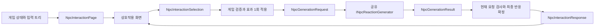

# NPC 상호작용 공통 데이터 규약 v1

작성일: 2026-10-12. Android에서 하나의 공유 SLM을 사용하고 도깨비별 특성과 최근 컨텍스트로 반응을 달리하는 기능의 내부 C# 계약이다. 입출력 상호작용 로직·게임 데이터 연결 계층·resilient 프레임워크·프론트엔드가 이 규약을 기준으로 병렬 개발한다.

## 적용 범위

이번 구현은 **데이터 타입, 형식 검증, 선택/응답 식별 검사와 공통 생성 인터페이스**다. 상호작용 트리 콘텐츠, 상태 저장소, 게임 효과 처리, 모델 설치·추론, 비동기 대기열·시간 제한·완료 잠금, NPC 입력 UI는 아직 구현하지 않았다. 실제 NPC인 `DokkaebiWanderer`에는 관리 횟수·오염도·개별 특성이 없다. 이 문서의 상태 필드는 신규 계약이며 현재 상태 연결 완료를 의미하지 않는다.

v1에서 **게임은 출력 분기·감정·동작·후속 선택지를 결정하고, SLM은 짧은 대사만 생성**한다. 기존 논의에서 아직 정하지 않은 모델의 행동 선택 범위를 확장하지 않기 위한 초기 개발 범위다. 감정/동작을 모델이 선택하게 하려면 허용 목록과 결과 검증을 포함하는 후속 계약 변경이 필요하다.

소스는 `Assets/Jamkkaebi/Scripts/Gameplay/Npc/Interaction/`, 네임스페이스는 `Jamkkaebi.Scripts.Gameplay.Npc.Interaction`이다. `Jamkkaebi.Gameplay` 어셈블리에 포함되며 `Jamkkaebi.UI → Jamkkaebi.Gameplay` 의존 방향을 유지한다. Unity 객체·표시 자산·추론 플러그인·JSON 라이브러리를 공통 타입에서 참조하지 않는다. 모델과 통합 도구는 미선정이다.

## 책임과 데이터 흐름



1. 게임 상태 소유자는 개체 특성·관리 횟수·오염도·최근 컨텍스트와 `StateVersion`을 관리한다. 화면에 줄 선택지는 입력 트리와 현재 조건으로 판정한다.
2. 프론트엔드는 선택지의 `ActionId`와 자신이 본 노드·상태 버전을 보낸다. 자유 입력, 상태 변경값, 출력 분기 ID를 플레이어 입력으로 받지 않는다.
3. 게임은 현재 노드·선택지·버전·조건을 다시 검사하고 `InteractionId`를 기준으로 효과를 **한 번만** 적용한다. 오래되거나 비활성인 선택은 재판정한 화면으로 갱신하고 생성 요청을 만들지 않는다.
4. 게임이 효과 적용 후 상태를 복사하고 출력 트리에서 `NpcResponsePlan`을 고른다. 데이터 연결 계층이 이를 생성 요청으로 구성한다. SLM에 상태 효과 재실행을 맡기지 않는다.
5. 공유 생성 서비스가 필요한 정보를 프롬프트에 직렬화한다. 모델은 대사만 반환하며 어댑터가 실행 핸들을 통해 `RequestId`를 붙인다. 모델에게 NPC ID나 요청 ID를 생성하게 하지 않는다.
6. 프레임워크는 현재 생성 시도·세션·상호작용·NPC·상태 버전, 시간 예산, 완료 여부를 검사한 후 성공 또는 기본 반응 **하나만** 확정한다. 프론트엔드도 표시 직전에 현재 대상과 완료 여부를 확인한다.

위 3·5·6 단계의 상태 소유자·트리 실행기·생성 어댑터·완료 관리 서비스는 후속 구현이다. 아래의 순수 데이터 검사 함수가 이 책임 전체를 대신하지 않는다.

## 식별자와 상태 버전

| 필드 | 의미·소유자 | 수명 |
| --- | --- | --- |
| `NpcId` | 상태 소유자가 부여하는 도깨비 **인스턴스** ID | 동일 개체의 수명. 영구 저장 연결 전에는 런타임 ID 가능 |
| `DefinitionId` | 콘텐츠가 정의하는 도깨비 종류/프로필 ID | 콘텐츠 정의의 수명 |
| `SessionId` | 상호작용 화면을 여는 측이 발급하는 세션 ID | 창 재개·NPC 전환 시 새 ID |
| `InteractionId` | 한 입력 의도를 식별하는 ID | 같은 입력 재전달에는 유지, 새 입력에는 새 ID |
| `NodeId` / `ActionId` | 입력 트리의 현재 노드 / 선택 행동 ID | 트리 콘텐츠 정의의 수명 |
| `BranchId` | 게임이 결정한 출력 반응 분기 ID | 출력 트리 콘텐츠 정의의 수명 |
| `RequestId` | 한 생성 시도의 ID | 생성 시도마다 새 ID. SLM 재시도가 게임 효과를 재실행하지 않음 |
| `ExpectedStateVersion` | 선택지 표시 때 UI가 본 상태 버전 | 입력 검증 기준 |
| `StateVersion` | 스냅샷에 담긴 상호작용 의미 상태 버전 | 관련 상태가 변할 때 단조 증가 |

ID는 대소문자를 구분하며 자동 trim/대소문자 변환을 하지 않는다. 영문·숫자·`-_.:`만 사용하고 길이는 1~64 UTF-16 코드 단위다. GUID 문자열을 사용할 수 있으며 생성 방식 자체는 이 규약이 강제하지 않는다. ID를 이름·좌표·종류 ID·서버 `artifactId`에서 추정하지 않는다. 현재 배치 캡처의 `home-dokkaebi`는 영구 개체 ID 구현이 아니다.

상태 버전에는 특성·관리 횟수·오염도·최근 기록·선택지 조건에 영향을 주는 변화를 포함한다. 걸음 수·이동 애니메이션 프레임·좌표만 변하는 것은 버전을 올리는 이유가 아니다. 효과 적용 전과 후 버전은 같거나 증가할 수 있다. 생성 요청의 버전이 선택 시 버전보다 낮으면 거부한다. 상태 저장소를 재생성할 때 이전 요청을 취소하고 새 세션을 열어 동일 버전 재사용을 구분한다.

## 공통 타입

| 타입 | 주요 필드 | 전달 방향 |
| --- | --- | --- |
| `NpcContextSnapshot` | 개체·종류·이름·버전, `Traits`, `CareCount`, `Pollution`, `RecentContext` | 게임 상태 → 화면·생성 요청 |
| `NpcInteractionChoice` | `ActionId`, 표시 이름, 사용 가능 여부, 불가 사유 | 게임 → 화면 |
| `NpcInteractionPage` | 세션, 현재 노드, 상태 스냅샷, 선택지 | 게임 → 화면 |
| `NpcInteractionSelection` | 세션·상호작용·개체·노드·행동 ID, 기대 버전 | 화면 → 게임 |
| `NpcReaction` | `Dialogue`, `EmotionId`, `GestureId` | 반응 계획/최종 반응 → 화면 |
| `NpcResponsePlan` | 분기·반응 의도·게임 사실, 기본 반응, 다음 노드·선택지 | 게임 출력 트리 → 프레임워크 |
| `NpcGenerationRequest` | 규약 버전·요청 ID, 선택, 효과 적용 후 스냅샷, 계획, 시간 예산 | 데이터 연결 계층 → 공유 생성 서비스 |
| `NpcGenerationResult` | 요청 ID, 최종 상태, 성공한 경우에만 대사 | 생성 서비스 → 프레임워크 |
| `NpcInteractionResponse` | 요청·세션·상호작용·개체·버전·분기, 최종 반응·출처·추론 상태·다음 선택지 | 프레임워크 → 화면 |
| `INpcReactionGenerator` | `Task<NpcGenerationResult> GenerateAsync(request, cancellationToken)` | 실제/모의 생성기 공통 경계 |

모든 데이터는 생성 후 불변이다. 외부 리스트는 생성 시 복사하고 읽기 전용 목록으로 노출한다. `null` 목록은 빈 목록이며 null/빈 텍스트 항목은 허용하지 않는다. 다음 선택지가 있으면 `NextNodeId`도 필요하고, 종료 반응은 둘 다 비운다. 동일 화면/다음 선택지 목록 안에서 `ActionId`가 중복되면 거부한다.

v1의 다음 노드는 플레이어가 선택할 메뉴이며 자동 진행만 있는 중간 노드는 표현하지 않는다. 조건식·효과·노드 전이 콘텐츠 자체와 콘텐츠 ID의 존재 검사는 트리 실행기/카탈로그가 담당한다.

`NpcInteractionPage.CanSelect`는 해당 페이지 데이터와의 일치 여부만 확인한다. 실제 상태·조건을 다시 조회하거나 `InteractionId` 중복을 기억하지 않는다. 호출 측이 최신 페이지를 만들고 실제 조건을 재검증해야 한다.

## 컨텍스트 필드와 크기

다음 수치는 v1의 입력·출력 크기 제한이며 실제 모바일 성능이나 게임 밸런스를 보장하지 않는다. 문자열 길이는 `.NET string.Length` 기준으로 토큰 수·화면 글자 수와 다르다.

| 필드 | v1 규약 |
| --- | --- |
| `DisplayName` / 선택지 `Label` | 비어 있지 않은 한 줄 텍스트, 최대 64 코드 단위 |
| `Traits` | 최대 8개, 항목당 80 코드 단위. 예: `장난스럽지만 고마움은 표현한다` |
| `CareCount` | 성공한 관리의 누적 횟수, 0 이상의 정수. `null`은 미연결/미확인 |
| `Pollution` | 정규화된 유한 실수 `[0,1]`, 0=깨끗함·1=최대 오염. `null`은 미연결/미확인 |
| `RecentContext` | 게임이 작성한 사실 요약, 오래된 것부터 최대 8개·각 160 코드 단위 |
| 반응 `Intent` / `Facts` | 의도 160 코드 단위, 확정 사실 최대 8개·각 160 코드 단위 |
| 현재/다음 선택지 | 최대 8개. 실제 UI 메뉴 개수·행동 목록 확정과는 별개 |
| `Dialogue` | 비어 있지 않은 한 줄 일반 텍스트, 최대 160 코드 단위 |
| `EmotionId` / `GestureId` | 게임 콘텐츠의 표현 ID. 해당 표현이 없으면 UI 어댑터가 기본 표현 사용 |
| `TimeBudgetMilliseconds` | 양의 정수. 실기기 결과를 바탕으로 서비스 설정에서 결정 |

원본 오염도 단위가 다르면 데이터 연결 계층이 명시적으로 정규화한다. 알 수 없는 값에 임의의 `0`을 넣지 않는다. 관리 횟수·오염도 갱신 모델과 실제 게임 규칙은 후속 구현이다. 최근 기록은 NPC별로 관리하고 다른 NPC의 기록이나 아직 검증하지 않은 모델 문장을 사실로 섞지 않는다.

대사는 일반 텍스트다. 프론트엔드는 rich text 해석을 끄며, 어댑터는 형식이 맞지 않는 모델 출력을 `InvalidOutput`으로 전달한다. 형식·길이 검사는 사실/의미 일치 검증이 아니므로 한국어 품질·게임 사실 준수는 별도 검증해야 한다. 단순히 최대 길이로 잘라 성공 처리하지 않는다.

## 요청 수명과 실패 결과

`GenerateAsync`는 모델 준비·대기열·추론·출력 검증을 포함하는 공유 서비스의 경계다. 실제/모의 구현은 게임 프레임을 막지 않고 예산 안에서 최종 결과를 반환해야 한다. 예산은 서비스 접수 때부터 비배율 단조 시간(`Stopwatch` 등)으로 측정하며 `Time.time`·기기 시계로 계산하지 않는다. 게임 판정과 UI 연출 시간은 별도이며 플레이어의 전체 체감 반응 시간도 통합 검증에서 측정한다.

| `NpcGenerationStatus` | 의미 | 현재 요청에 대한 처리 |
| --- | --- | --- |
| `Succeeded` | 검증을 통과한 완성 대사 | 계획의 감정·동작·분기를 유지하고 대사만 적용 |
| `TimedOut` | 예산 초과 | 같은 계획의 기본 반응 |
| `ModelUnavailable` | 모델 미설치·미준비 등 | 같은 계획의 기본 반응 |
| `Failed` | 실행 오류 | 같은 계획의 기본 반응 |
| `InvalidOutput` | 형식·길이·의미 검증 실패 | 같은 계획의 기본 반응 |
| `QueueFull` | 작업 접수 한도 초과 | 같은 계획의 기본 반응 |
| `Cancelled` | 종료·대상 전환 등으로 취소 | 새 반응 표시 없음 |

오래된 생성 시도·세션·상호작용·NPC·상태 버전은 실패 기본 반응도 표시하지 않는다. 이는 추론 상태가 아니라 요청 적용 가능성의 문제다. `NpcInteractionResponse.TryResolve`는 결과의 요청 ID와 **현재 활성 요청 ID**·현재 대상·상태 버전을 검사하고 취소 결과를 거부한다. 같은 상호작용에서 생성 시도가 교체되었다면 이전 시도의 결과를 거부한다. 성공하면 게임 계획의 분기·감정·동작·다음 선택지를 그대로 사용한다.

**이 함수는 상태 없는 데이터 조립 함수다.** 이미 확정한 요청을 다시 넘기면 또 응답을 만들 수 있으므로, 프레임워크의 요청별 완료 잠금과 프론트엔드의 중복 표시 방지는 별도로 구현해야 한다. 시간 초과로 기본 반응을 확정한 뒤 도착한 성공 결과는 완료 잠금에서 차단한다. `TryResolve` 자체가 시간 예산·실제 게임 상태·의미 일치를 검사한다고 가정하지 않는다.

취소 토큰이 오면 서비스는 `Cancelled`를 반환하거나 `OperationCanceledException`으로 종료할 수 있다. 프레임워크는 둘 다 표시 없는 취소로 처리하고 미처리 Task 예외를 남기지 않는다. 알려진 실행 실패는 결과 상태로 반환하며 예상하지 못한 예외도 경계에서 처리한다. 실제 네이티브 추론 중단과 늦은 결과 차단을 함께 마련한다. 실패로 게임 효과를 재실행하거나 되돌리지 않는다.

하나의 모델을 공유하되 NPC별 상태·최근 컨텍스트는 게임에서 관리한다. 어댑터는 요청마다 전달된 정보를 사용하고 다른 NPC의 채팅 기록/가변 추론 상태를 재사용하지 않는다. 고정 프롬프트 캐시는 의미 상태와 분리해 활용할 수 있지만 사전 생성 대사의 재사용·무효화 정책은 후속 프레임워크 범위다. v1에는 별도의 캐시 데이터 스키마를 추가하지 않는다.

## 최소 사용 예시

아래는 테스트용 샘플이다. 관리 행동·성격·감정·동작 ID·800ms는 콘텐츠나 실기기 확정값이 아니다. 화면은 버전 4를 봤고 게임이 관리를 한 번 적용해 버전 5가 된 상황이다.

```csharp
var selection = new NpcInteractionSelection("session-1", "interaction-1", "npc-1",
    "home-menu", "care", 4);
var context = new NpcContextSnapshot("npc-1", "prototype-dokkaebi", "도깨비", 5,
    new[] { "장난스럽지만 고마움은 표현한다" }, 3, 0.2f,
    new[] { "플레이어가 관리를 마쳤다" });
var plan = new NpcResponsePlan("care-relieved", "관리 후 안도와 감사를 표현한다",
    new NpcReaction("휴, 한결 나아졌어. 고마워!", "relieved", "nod"),
    new[] { "관리 효과는 이미 적용되었다", "현재 오염도는 0.2다" });
var request = new NpcGenerationRequest("request-1", selection, context, plan, 800);

// 실제/모의 생성기는 이 인터페이스로 교체한다.
NpcGenerationResult result = await generator.GenerateAsync(request, cancellationToken);
// 호출 전에 프레임워크에서 시간 예산과 요청별 완료 잠금을 검사한다.
if (NpcInteractionResponse.TryResolve(request, result, activeRequestId, activeSessionId,
    activeInteractionId, activeNpcId, currentStateVersion, out NpcInteractionResponse response))
{
    // 메인 스레드에서 현재 화면을 다시 확인하고 response를 한 번만 표시한다.
}
```

이 데이터는 **프로세스 내부 계약**이며 서버 API·저장 포맷·모델 프롬프트 JSON 스키마가 아니다. 필요하면 어댑터에서 직렬화하되 v1 필드의 의미·null·ID를 보존한다. 생성자나 코드의 규약 버전만으로 외부 JSON을 안전하게 읽는다고 가정하지 않는다. 외부 DTO·역직렬화·프롬프트 템플릿은 추론 도구 선정 후 작성한다.

## 검증과 후속 작업

- `Assets/Jamkkaebi/Tests/EditMode/NpcInteractionContractTests.cs`: 불변 스냅샷, 입력 조건, ID·버전, 취소·실패·최종 반응 규칙.
- `Tools/VerifyNpcInteractionContracts.ps1`: Unity 없이 공통 소스를 컴파일하고 25개 시나리오 그룹을 확인하는 PowerShell 7 검사. `/doc`로 XML 주석 진단을 활성화하고 공개 멤버 주석 누락(CS1591), XML 형식·매개변수·참조 오류(CS1570/1572/1573/1574/1587)를 오류로 처리한다. Add-Type 메모리 컴파일은 XML 문서 파일을 내보내지 않는다. Unity 컴파일·EditMode·Android 실행 검증 및 원격 리뷰 도구의 coverage 판정을 대체하지 않는다.
- 후속: 상태 소유자·최소 입출력 트리, 실제 데이터 연결, 모의 생성기·요청 수명 서비스, 화면 입력·반응 표시, 실제 모델 어댑터.
- 후속 통합 검증: 게임 효과/표시 1회, 시간 초과 후 늦은 결과, NPC/세션 전환, 앱 복귀, 모델 미준비와 장시간 부하. 이번 데이터 검사 통과를 이 실행 기능의 완료로 해석하지 않는다.
