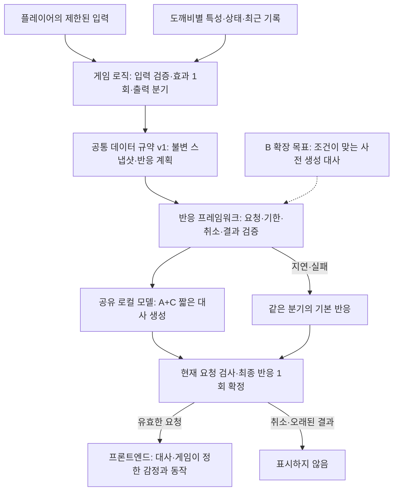
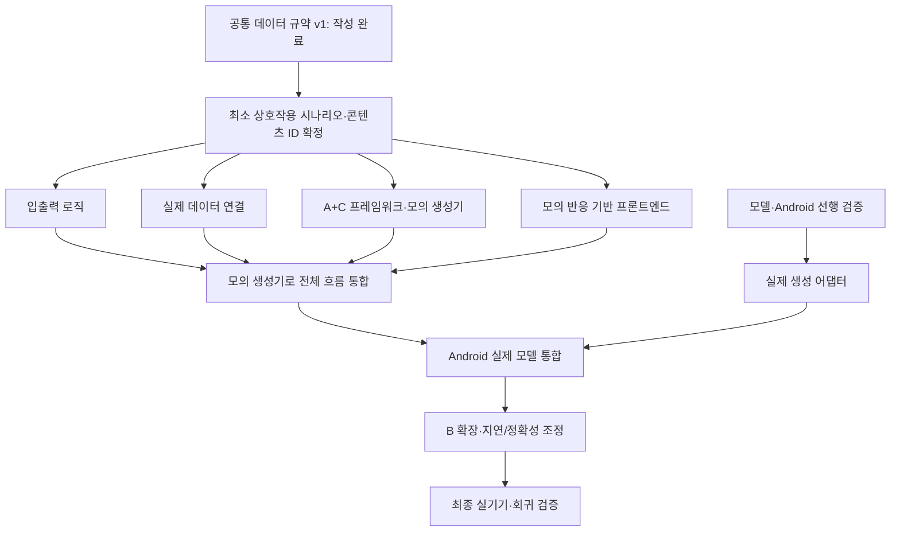

# 도깨비 NPC 상호작용 세션 정리

기준일: 2026-10-12. 최신 사용자 결정은 **A+C 기반으로 먼저 제작하고 B를 확장 목표로 삼는 것**이다. 이 문서는 결정·검토안·실제 구현 상태를 구분한 요약이다. 상세 규약과 후보 비교를 중복 정의하지 않고 아래 원본으로 연결한다.

## 확정된 방향

| 항목 | 현재 결정 |
| --- | --- |
| 목적 | 클라이언트에서 자체적으로 동작하는 AI를 활용한 도깨비 NPC 상호작용 |
| 플랫폼 | Android |
| 플레이어 입력 | 자유 입력 범위를 넓히기보다 제한된 상호작용 창구 제공. 구체적인 메뉴는 미확정 |
| 모델 공유 | NPC마다 모델을 두지 않고 하나의 로컬 모델 공유 |
| 개별 반응 | 도깨비 특성·관리 횟수·오염도·최근 컨텍스트로 같은 입력의 반응 차별화 |
| 입력/출력 흐름 | 입력 선택지·조건·게임 효과와 출력 반응 분기·후속 흐름을 게임 로직에서 정의 |
| 초기 v1 역할 | 게임이 분기·감정·동작·다음 선택지를 정하고 모델은 짧은 한국어 대사만 생성 |
| 개발 방식 | **A+C 먼저 구현 → 검증 → B로 확장** |
| 우선순위 | 지연과 정확성 |
| 완성 목표 | **2026-10-30까지 최소 기능 완성**. 상세 최소 콘텐츠·기기 조건은 미확정 |

입출력 트리는 모든 대사를 고정하는 것이 아니라 게임 의미·허용 행동·후속 흐름을 정하는 구조다. 출력은 초기 반응 분기표로 시작하고 필요한 부분을 트리로 연결하는 방향을 검토했다. 트리 콘텐츠·실행기는 아직 없다.

## 전체 구조

아래는 목표 구조다. 현재 구현된 부분은 가운데 데이터 규약과 순수 검사 함수이며 실제 생성 서비스와 UI는 아직 연결되지 않았다.

번호별 상세 구조와 분리된 구성 요소 주석은 [도깨비 AI 얼개](npc-ai-architecture.md)를 확인한다.

모델이 생성한 문장에서 게임 명령을 실행하지 않는다. 상태 변화·반응 분기·다음 선택지는 게임의 판정 결과를 유지한다. 모델이 늦어져도 이미 확정한 게임 효과를 재적용하거나 되돌리지 않는다.

## A+C와 B의 의미

| 단계 | 구성 | 구현 목표 |
| --- | --- | --- |
| **먼저 제작: A** | 입력 후 현재 상태/반응 계획으로 로컬 추론 | 최소 실제 생성 경로와 정확한 지연 측정 |
| **함께 적용: C** | 게임이 작성한 반응 의도·사실·말투·짧은 예시 | 한국어·캐릭터·게임 사실을 지키는 제한 생성 |
| **확장 목표: B** | 유효한 사전 생성 대사 우선, 없으면 예산 내 즉석 생성 | 준비된 반응으로 추론 대기 경로 감소 |

B는 A+C를 대체하는 별도 모델이 아니라 반응 준비/조회 계층을 더하는 방식이다. 관리 같은 상태 변화 행동의 준비 대사는 실제 효과 적용 후 계획과 일치할 때만 쓴다. 다른 NPC·다른 상태·다른 분기의 대사를 재사용하지 않는다.

기본 반응은 A+C부터 준비한다. 시간 초과·모델 미준비·실행 오류·부적합 출력에 사용하며, 취소나 현재 대상이 바뀐 경우에는 새 반응을 표시하지 않는다.

## 작업 영역과 병렬 진행

**선행 검증:** 모델·통합 도구 선정과 Android 실행/품질/성능 확인. 기존 도구로 충족하면 별도 대규모 모바일 이식 작업은 줄어든다. 충족하지 못하면 추가 연결 작업이 필요하다.

| 개발 영역 | 책임 | 현재 상태 |
| --- | --- | --- |
| 입출력 상호작용 로직 | 선택 조건·게임 효과·출력 분기·다음 노드·기본 반응 | 공통 타입 있음. 트리 콘텐츠/실행기·효과 로직 없음 |
| 게임 데이터 연결 계층 | 실제 NPC 상태를 스냅샷/요청으로 구성하고 결과 대상 연결 | DTO 있음. 실제 상태 소유자·연결 계층 없음 |
| Resilient 프레임워크 | 공유 추론·대기열·기한·취소·실패·최종 확정 관리 | 인터페이스/결과 조립 검사 있음. 실행 서비스 없음 |
| 상호작용 프론트엔드 | 제한된 메뉴·시각 반응·대사·표현·종료 | 아직 미구현 |

공통 계약이 있으므로 전체 트리나 모델 검증을 모두 끝낼 때까지 화면 개발을 기다릴 필요는 없다. 작은 흐름 하나와 콘텐츠 ID를 맞춰 병렬 개발한다. 실제 반응 시간의 정책 조정과 최종 검증에는 통합 빌드·실기기가 필요하다. 인원별 배정은 아직 정하지 않았다.

## 이번 세션에서 완료한 것

- [공통 데이터 규약 v1](npc-interaction-contract.md)과 순수 C# 타입 13개, 생성기 공통 인터페이스를 작성했다.
- 스냅샷 목록 복사·읽기 전용, 값/형식 검증, 선택 일치와 활성 요청·NPC·세션·버전 검사를 구현했다.
- 관리 횟수는 성공한 관리 누적, 오염도는 `[0,1]`, `null`은 미연결/미확인으로 정의했다. 실제 상태 갱신 모델은 아직 없다.
- NUnit EditMode 테스트와 Unity 없이 실행할 검사 도구를 작성했다. **순수 C# 컴파일과 25개 시나리오 그룹 통과**를 확인했다.
- [LLM 적용 계획](npc-llm-application-plan.md)에 후보 도구·생성 전략·평가 기준·구현 단계를 정리했다.

**미실행:** Unity Editor 경로 미확보로 Unity 컴파일·EditMode·Player·IL2CPP 실행은 하지 못했다. Android 실기기·실제 모델 품질/속도도 측정하지 않았다. 실제 SLM·NPC 상태·UI 기능이 완성된 것은 아니다.

## 검토했으나 미확정인 항목

| 항목 | 현재 검토안 |
| --- | --- |
| 추론 도구 | LLMUnity CPU 기준선 우선 검토, 필요하면 LiteRT-LM Android 연결 비교 |
| 모델 | Qwen3-0.6B / 1.7B를 첫 품질·지연 비교 후보로 제안 |
| 최소 지원 기기·RAM | 사용자 확인 결과 미확정 |
| 입력 메뉴·캐릭터 콘텐츠 | 예시만 논의. 실제 행동 목록·특성·기본 대사·표현 자산 미확정 |
| 응답 예산·부하 정책 | 실기기 측정 후 결정 |
| 초기 최소 완성 범위 | 도깨비 한 마리·소수 입력·짧은 반응·기본 반응·실제 Android 연결을 제안 |
| 담당 인력 | 병렬 진행할 인원/담당 배정 미확정 |

공식 도구 자료 확인 결과 LLMUnity 기본 Android GPU 가속을 가정할 수 없었다. 도구를 설치하면 실제 배포 라이브러리와 버전을 다시 확인한다. 모델·양자화·배포/로딩 정책·실제 메모리도 아직 선택하지 않았다. 자세한 근거와 후보별 구현 내용은 LLM 적용 계획에 있다.

## 지연과 정확성의 판단 기준

- **지연:** 첫 시각 반응과 검증된 최종 표시 시간을 구분한다. p95·제한 시간 초과율·cold/warm·cache hit/miss·기본 반응 원인을 측정한다.
- **정확성:** 게임 사실·출력 분기, 해당 도깨비 컨텍스트, 성격/말투·한국어, 형식을 각각 평가한다.
- **함께 볼 지표:** 제한 시간 내 검증을 통과해 표시한 생성 반응 비율. 기본 대사가 대부분인 상태를 모델 성공으로 보고하지 않는다.
- **미확정 목표 제안:** 첫 시각 반응 100ms, 최종 반응 p95 1초, 생성 후보 의미 통과율 95%, 사용 가능한 생성 반응 80%. 실측·제품 확정 수치가 아니다.
- 게임 효과/표시 중복·요청 대상 혼입은 테스트에서 모두 차단해야 한다. 문법/길이 검증만으로 생성 문장의 의미 정확성을 보장할 수는 없다.

## 10월 30일까지의 제안 일정

| 기간 | 확인 지점 |
| --- | --- |
| 10/12–14 | 최소 콘텐츠·후보·평가 입력 준비, 기기 확보 시 실행 가능성 확인 |
| 10/15–18 | A+C 기준 구현과 네 영역 병렬 개발. 18일 모의 전체 연결 목표 |
| 10/19–21 | 실제 Android 모델·화면 통합. 지연/품질로 도구·모델 선택 |
| 10/22–25 | B 확장, cache 정확성·혼합 입력·지속 부하 검증 |
| 10/26–27 | 모델·정책 고정, 완료 후보 빌드 확보 |
| 10/28–30 | 회귀 검증·버그 수정·최종 Android 빌드 |

30일은 사용자 목표이며 중간 날짜와 인력 전제는 계획 제안이다. 테스트 기기/Unity 환경 확보가 늦으면 실행 가능성 확인 일정도 재평가해야 한다. 기한에 쫓겨 모의 생성기나 기본 대사만 동작하는 상태를 모델 기능 완성으로 보고하지 않는다.

## 다음 착수 항목

최소 상호작용 시나리오와 평가 fixture를 정하고, A+C용 프롬프트·검증 기준과 모의 요청 수명 서비스를 만든다. 모델/도구 검증과 프론트엔드 개발은 이 최소 흐름의 계약으로 병행한다. 이번 요청에서는 요약과 결정 반영만 수행하며 해당 기능 구현에 새로 착수하지 않는다.
